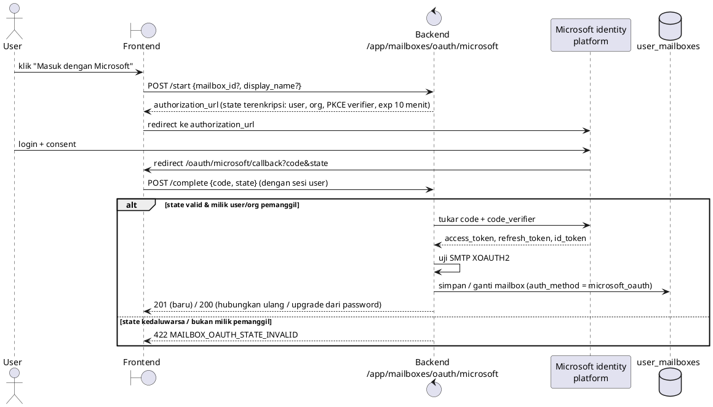

# Mailbox Microsoft (Outlook.com / Microsoft 365) via OAuth 2.0

## Masalah

Menghubungkan mailbox Outlook.com/Hotmail atau Microsoft 365 dengan password gagal:

```
smtp auth: 504 5.7.4 Unrecognized authentication type
```

Ada dua penyebab:

1. `smtp.office365.com` hanya mengiklankan `AUTH LOGIN XOAUTH2`, sedangkan klien SMTP lama selalu
   memakai `AUTH PLAIN`.
2. Microsoft sudah menonaktifkan basic auth (password) untuk SMTP/IMAP Outlook.com dan sedang
   menghentikannya untuk Exchange Online. Jalur yang didukung adalah OAuth 2.0 + SASL `XOAUTH2`.

## Solusi yang diimplementasikan

- SMTP: `internal/platform/mail/auth.go` memilih mekanisme otomatis — `XOAUTH2` bila ada access
  token, `PLAIN` bila diiklankan, `LOGIN` bila server hanya menawarkan `LOGIN`.
- IMAP: `AUTHENTICATE XOAUTH2` (`imap_conn.go`) untuk mailbox OAuth.
- Kolom baru `user_mailboxes.auth_method` (`password` | `microsoft_oauth`), cache access token
  terenkripsi (`access_token_encrypted`, `access_token_expires_at`) — migration `000186`.
  Untuk mailbox OAuth, `secret_encrypted` berisi **refresh token** (dirotasi setiap refresh).
- Token di-refresh otomatis saat kirim/sync/test bila sisa umurnya < 3 menit. Grant yang dicabut
  (`invalid_grant`) menandai mailbox `error` dengan pesan untuk menghubungkan ulang.

### Alur



`state` dicocokkan dengan user dan organisasi yang sedang login, sehingga tautan login milik orang
lain tidak bisa dipakai untuk menempelkan akun Microsoft ke user yang salah.

### Endpoint (permission `email.read` / `email.send`)

| Method | Path | Keterangan |
|---|---|---|
| GET | `/api/v1/app/mailboxes/oauth/microsoft` | `{enabled}` — server punya app registration |
| POST | `/api/v1/app/mailboxes/oauth/microsoft/start` | body `{mailbox_id?, display_name?}` → `{authorization_url}` |
| POST | `/api/v1/app/mailboxes/oauth/microsoft/complete` | body `{code, state}` → mailbox |

Response mailbox sekarang memuat `auth_method`.

## Registrasi aplikasi di Microsoft Entra ID

Dilakukan sekali per environment (dev dan prod boleh satu app dengan dua redirect URI, atau app
terpisah).

1. Buka <https://entra.microsoft.com> → **Applications → App registrations → New registration**.
   - Name: mis. `Zyad Cloud Mail`.
   - Supported account types: **Accounts in any organizational directory and personal Microsoft
     accounts** (sesuai `MICROSOFT_OAUTH_TENANT=common`).
   - Redirect URI: platform **Web**, nilai `https://<frontend-host>/oauth/microsoft/callback`
     (harus sama persis dengan `MICROSOFT_OAUTH_REDIRECT_URL`).
2. **Certificates & secrets → New client secret** → salin *Value* (hanya tampil sekali). Catat
   tanggal kedaluwarsanya; perbarui sebelum habis.
3. **API permissions → Add a permission → Microsoft APIs → Microsoft Graph → Delegated**:
   `IMAP.AccessAsUser.All`, `SMTP.Send`, `offline_access`, `openid`, `email`, `profile`.
   (`Office 365 Exchange Online` di tab *APIs my organization uses* hanya muncul bila direktori
   punya lisensi M365; izin Graph di atas setara.) Daftar ini hanya pra-deklarasi: scope
   `https://outlook.office.com/...` tetap diminta saat login. Admin consent tidak wajib, kecuali
   tenant M365 pelanggan membatasi user consent.
4. **Overview** → salin *Application (client) ID*.
5. Isi `.env` backend (jangan commit):

   ```bash
   MICROSOFT_OAUTH_CLIENT_ID=<application-client-id>
   MICROSOFT_OAUTH_CLIENT_SECRET=<client-secret-value>
   MICROSOFT_OAUTH_TENANT=common
   # opsional; default APP_FRONTEND_URL/oauth/microsoft/callback
   MICROSOFT_OAUTH_REDIRECT_URL=https://<frontend-host>/oauth/microsoft/callback
   ```

   Restart API **dan** worker (worker juga me-refresh token saat sync inbox / kirim dokumen).

## Syarat di sisi akun Microsoft 365

- Admin tenant harus mengizinkan **Authenticated SMTP** untuk mailbox tersebut
  (Microsoft 365 admin center → Users → Mail → *Manage email apps* → *Authenticated SMTP*), dan
  SMTP AUTH tidak dinonaktifkan di level organisasi. Tanpa ini SMTP XOAUTH2 ditolak dengan
  `535 5.7.139`.
- IMAP harus aktif untuk mailbox bila sync inbox dipakai.
- Outlook.com pribadi tidak perlu pengaturan tambahan.

## Troubleshooting

| Gejala | Penyebab / tindakan |
|---|---|
| Tombol Microsoft tidak muncul | `MICROSOFT_OAUTH_CLIENT_ID` kosong atau API belum di-restart |
| `AADSTS16000` saat membuka portal Entra dengan akun Outlook pribadi | Akun belum punya direktori → daftar Azure (free) untuk membuat *Default Directory*, atau pakai akun admin M365 |
| `invalid_request` … `userAudience` … `Consumer` | App terdaftar "Personal Microsoft accounts only" → ubah *Supported account types* ke "any organizational directory and personal Microsoft accounts" (Manifest `signInAudience: AzureADandPersonalMicrosoftAccount`) |
| `AADSTS50011` redirect URI mismatch | Redirect URI di Entra ≠ `MICROSOFT_OAUTH_REDIRECT_URL` |
| `AADSTS65001` / consent required | Tenant M365 membatasi user consent → admin memberi consent |
| `AADSTS7000215` invalid client secret | Secret salah/kedaluwarsa → buat secret baru |
| `535 5.7.139 Authentication unsuccessful` | Authenticated SMTP dimatikan untuk mailbox/tenant |
| Status mailbox `error`: *authorization expired or was revoked* | Refresh token tidak berlaku (password diganti, consent dicabut, 90 hari tidak dipakai) → klik **Hubungkan ulang** |
| `MAILBOX_OAUTH_STATE_INVALID` | Login Microsoft > 10 menit, atau callback dibuka di sesi user lain → ulangi |
